# 🛡️ LocalGuard – Your Local Security Guardian

> Smart. Secure. Reliable. Lightweight, offline checks for your own local files.

<p align="center">
  
</p>

## About the Project

LocalGuard is a security-focused tool for reviewing local files before sharing
them. Its current release is a dependency-free Python command-line application
that checks text files for likely accidentally committed credentials and
inspects supported documents for embedded metadata that may reveal author names
or document details. It runs locally and works offline.

Python powers the scanner and its application logic. HTML5 and CSS3 are used
for the project's branding and browser-based logo preview; LocalGuard is
currently a command-line tool rather than a web dashboard.

### Project Objectives

LocalGuard aims to make local file reviews straightforward and understandable,
with useful results, clear usage, and minimal setup.

### Key Highlights

- Detects common credential patterns in UTF-8 text files.
- Keeps matched credential values out of the scan output.
- Inspects Office Open XML core properties and basic PDF info fields.
- Reports when JPEG EXIF or PNG text metadata is present.
- Provides readable terminal output and machine-readable JSON.
- Uses a simple command-line interface and runs offline.
- Has a maintainable structure that can support future local-file features.

> **Scope:** Use LocalGuard to audit files you own or are authorized to review.
> Its pattern checks can produce false positives and are not a replacement for
> secret management or a dedicated security review.

### Project Vision

LocalGuard is intended to grow into a practical, accessible local security
toolkit. Future work may explore richer security insights, additional file
checks, customizable reporting, or an optional local dashboard; these are
potential directions, not features in the current release.

## Technologies Used

- **Python** — scanner and command-line application logic.
- **HTML5** — structure for the branding preview page.
- **CSS3** — styling and animation for the branding preview.

<p align="center">
  
</p>

## Logo

<p align="center">
  
</p>

Open [localguard-logo-preview.html](localguard-logo-preview.html) in a browser
to preview the animated logo. The [animated hero SVG](assets/localguard-hero.svg),
[static hero PNG](assets/localguard-hero.png), [static logo SVG](assets/localguard-logo.svg),
[animated logo SVG](assets/localguard-logo-animated.svg),
[transparent logo PNG](assets/localguard-logo.png), and
[favicon](assets/localguard-favicon.svg) are available for use in a website,
README, or app. The SVG animations respect reduced-motion preferences.

## Requirements

- Python 3.10 or newer

## Install

From the project directory:

```powershell
py -m pip install -e .
```

## Usage

Scan the current project for likely credentials:

```powershell
localguard scan
```

Scan a specific directory or emit JSON:

```powershell
localguard scan .\path\to\project
localguard scan .\path\to\project --json
```

Inspect supported embedded metadata in your local files:

```powershell
localguard metadata .\path\to\project
localguard metadata .\path\to\project --json
```

The credential scanner checks UTF-8 text files up to 1 MB. Both commands skip
common generated and dependency directories and ignore symlinks. The metadata
command displays metadata it finds; review its output before sharing files.

Credential scan exit codes are `0` for no findings, `1` when findings are
present, and `2` when scanning encounters errors or the supplied path is not a
directory.

## Development

Run the test suite with:

```powershell
py -m unittest discover -s tests
```

## Why LocalGuard?

LocalGuard focuses on clarity and privacy when reviewing local files. Its
offline checks are designed to help users spot potential issues before sharing
their work.

## License

This project is released under the MIT License. See [LICENSE](LICENSE).

**LocalGuard — Smart. Secure. Reliable.**

*Building a safer local digital environment, one step at a time.*
